# UTXOPlay: player identity, community and item economy

Status: implemented store/community features plus a proposed CKB asset integration. Updated 2026-10-24.

## What ships now

Wallet authentication remains a browser-bound, single-use signed login challenge. After signing in, a player can choose a unique, case-insensitive public username in the wallet account panel. Names are 3–24 ASCII letters, digits or underscores; reserved official names are rejected. A username is a mutable display name, not an ownership key. Library, purchases and saves continue to use the authenticated account ID. Public review payloads omit wallet addresses and account IDs.

Every bundled game has a community page at `/community/:game`, accessible from store details, the Community navigation entry and its in-game overlay: recommend/not recommend, a 1–5 rating, all-time and last-30-days aggregates, helpful votes, editable reviews, paginated replies, deletion by the author and abuse reports. One wallet account can publish one review per game after a successful game action has passed through the authenticated runtime proxy. Reading state or replaying a session does not qualify. This is a server-observed participation check, not measured playtime, proof of a unique human, or an on-chain attestation. Earlier plays are not backfilled from page views; existing players qualify on their next accepted action. Guest play stays available, but publishing requires wallet authentication. Vendor games are outside this initial participation adapter.

The Item Store at `/items` presents nine existing items from Neon Prospector and Skyward, with game filters, search, current game balances and an owned-item view. Miner prices come from the existing rule module; Skyward prices match the native shop. A catalog click opens the existing store inside the game picture after its loader reports readiness. It does not spend coins. The native game store remains authoritative for current price, stock, purchase, equip and use. Catalog balances are a snapshot and have an explicit refresh control. Unknown/unavailable balances are never displayed as zero.

Coins are earned through play, scoped to a game and account, and non-transferable. A new adventure may reset its balance and items. No CKB checkout, NFT minting, trading, deposit or withdrawal is enabled by this release. Existing paid vendor-game licensing remains a separate system.

## Product references and adaptations

Steam's [user review design](https://store.steampowered.com/reviews/) combines recommendations, helpful votes, editable reviews and discussion. UTXOPlay adopts those functional patterns with its own artwork and visual language. Counts start at zero; no promotional reviews, synthetic scores or invented playtime are seeded in production.

Epic's [ratings and polls design](https://store.epicgames.com/en-US/news/the-epic-games-store-ratings-and-polls-update) presents a five-point score and player-derived discovery signals. We adopt a compact rating summary and clear separation of aggregate scores from individual opinions. We do not claim Epic's randomized survey or two-hour eligibility system; our games are short arcade sessions and we do not yet measure authenticated active playtime. Player polls and confidence thresholds for discovery tags are future work, not shipped functionality.

Steam's [Inventory Item Store](https://partner.steamgames.com/doc/features/inventory/itemstore) separates item discovery from game-specific inventory definitions. UTXOPlay similarly groups items by game and shows ownership, but retains the requested earned-coin economy and in-game purchase controls. There is no real-money or peer-to-peer market in the present item store.

## The proposed asset model

Keep gameplay consumables in Myelin game state. Use CKB-backed objects first for durable cosmetic ownership, collectible achievements and creator editions. Avoid making every shot, EMP charge or retry an L1 transaction.

| Item class | Source of truth | Transfer | Initial implementation |
| --- | --- | --- | --- |
| Earned coins, consumables, run upgrades | Game's authenticated native session | None | Already available in Miner and Skyward |
| Cosmetic entitlement | Live CKB Spore Cell plus pinned game asset manifest | Owner-authorized CKB transaction | Proposed |
| Procedural collectible appearance | Spore content/DNA and a verified, pinned DOB decoder | Same Spore transfer | Proposed |
| Gameplay achievement export | Finalized Myelin application evidence, followed by a separate CKB issuance policy | Policy-specific | Proposed |
| Player-to-player sale | Atomic payment/asset CKB transaction with an explicit marketplace policy | On-chain | Deferred |

### Spore and DOB roles

[Spore's technical design](https://docs.spore.pro/basics/technical-design/) specifies the asset content and optional Cluster association. The Cluster identifies an edition or collection; it is not a container holding the inventory. Pin the exact network, deployed script code hash/hash type, dependencies and accepted Cluster IDs. A matching image or user-supplied collection name does not establish authenticity. A live Cell's lock determines control; sign-in alone must never grant authority to spend it.

[DOB/0](https://docs.spore.pro/dob/dob0-protocol) supplies a DNA/pattern/decoder arrangement for deriving traits. [DOB/1](https://docs.spore.pro/dob/dob1-protocol) offers additional composition for rendered objects. Start with one pinned DOB/0 decoder and a restricted trait schema before considering DOB/1 composition. Do not invent a custom `dob/0` format that merely resembles the standard.

For a cosmetic mining claw, DNA could select an alloy palette, light pattern and ornamental trim. Those traits must not change scoring, physics or collision bounds. Allowlisted game assets map the decoded trait values to local render layers. Decoder results are untrusted: enforce byte, CPU, memory and output limits; reject unexpected fields and types; never execute returned HTML, scripts or arbitrary remote URLs. Pin exact decoder bytes, including when discovery uses a mutable Type ID. Decoder upgrades require an explicit new accepted asset policy, not silent reinterpretation of existing ownership.

A permanent trophy can commit a compact achievement manifest and exact evidence digest. Do not promise that the Spore scripts independently prove a game result: they enforce their asset protocol, while achievement eligibility needs a separately verified issuance rule. If an issuer signs awards centrally, say so explicitly.

### CKB capacity, fees and custody

CKB's [Cell model](https://docs.nervos.org/docs/basics/concepts/cell-model/) uses capacity for occupied state. Before minting, show the exact capacity allocated to the object, network fee, outputs, owner lock and issuer/sponsor contribution. Estimate from the actual serialized transaction and current live Cells. Do not label the allocated capacity as an arcade coin price or promise a market value.

A sponsored transaction still needs an identified payer and explicit spending bounds. Login signatures do not authorize asset transfers. Melting is a separate destructive action supported only when the exact Spore content and scripts permit it; it is not a gameplay “consume” shortcut and must not be offered for immortal objects. This design does not enable melting in the first release.

Prefer wallet custody. UTXOPlay stores read models and entitlement references, not private keys. Define a signer capability matrix using actual transaction construction/signing tests for each supported wallet. Passing message authentication is not proof that a wallet supports the required Spore transaction.

## Runtime boundary and receipts

Myelin is an off-chain finite-Cell session runtime aligned with CKB concepts. It is neither a CKB full node nor a finished permissionless L2. Today's UTXOPlay games use authority-signed off-chain replay. A valid game replay is not a CKB settlement receipt and does not automatically make an earned item transferable.

Proposed flow:

```mermaid
flowchart LR
    Wallet[Authenticated wallet] --> Catalog[Item catalog]
    Catalog --> Game[In-game shop and inventory]
    Game --> Runtime[Myelin authoritative session]
    Runtime --> Evidence[Exact finalized execution evidence]
    Evidence --> Issuer[Bounded issuance policy]
    Issuer --> Preview[Wallet transaction preview]
    Preview --> Adapter[myelin-ckb-adapter receipt verification]
    Adapter --> CKB[CKB Spore issuance or transfer]
    CKB --> Reader[Canonical live-Cell entitlement reader]
    Reader --> Game
```

The pure projector stops at canonical CKB wire encoding. Context validation, strict script verification, node acceptance, commitment and configured-depth confirmation require the exact linked `myelin-ckb-adapter` receipt chain and offline re-verification. A receipt for transaction A cannot promote transaction B. Node acceptance is not commitment; confirmation depth is not irreversible finality. Local devnet evidence is not public-testnet court evidence.

Follow the authoritative Myelin documents in the sibling repository: `README.md`, `docs/MYELIN_ARCHITECTURE.md`, `MYELIN_CKB_SEMANTIC_DEVIATIONS.md` and `MYELIN_CKB_PROJECTION_AUDIT.md`. An inspected snapshot cannot reserve inventory, advance a session or emit an executable mint outbox entry.

### Issuance and recovery proposal

1. A finalized game transition establishes eligibility under a pinned program/profile and resource policy. Do not accept a client score, a screenshot or a caller-supplied success flag.
2. Atomically create a pending award and outbox record keyed by network, account, game profile, session, finalized frame and award definition. The reward nullifier can be consumed at most once. Bind content digest, Cluster, owner lock and mint policy at this point.
3. Build and preview an unsigned transaction. Persist its exact input reservation and raw transaction ID before requesting wallet approval. A rejected signature does not mint an asset or mark a reward delivered.
4. Submit and collect receipts. Retry the same logical issuance using the persisted state; never mint a second object because a request timed out. On conflict, re-resolve canonical live inputs and require a new preview for any changed transaction.
5. Display precise pending/accepted/committed/confirmed states from reverified receipts. Deliver the collectible entitlement only at the configured evidence gate. Reorgs can move an entitlement back to pending; disable transfers or competitive use until recovery completes.
6. Retain a reconciler and operator-visible failed-job queue. Test crashes before and after each commit, signature and submission boundary.

### Owning, equipping and transferring

An entitlement key includes network genesis identity, Spore ID, accepted type-script declaration, Cluster and exact policy/manifest digest. A wallet address alone is not an asset ID. Resolve the current live OutPoint and lock from a canonical CKB context. An indexer is a discovery service, not the sole proof of ownership. Cache entries bind the canonical header and have bounded freshness; a transfer or reorg invalidates the old owner's entitlement.

For a first cosmetic release, check ownership at equip and at the next session boundary. Define the behavior during an already-running match explicitly: the original cosmetic snapshot can remain visual-only until the match ends, but cannot create rewards or financial claims. A recipient must pass a fresh live-Cell check before equipping. If later assets affect gameplay or rewards, require an exclusive session authorization/escrow policy that prevents concurrent use and binds expiry, recipient, game profile and exact session. Do not infer escrow from a read-only ownership check.

Consumables should remain native session state. If a later tokenized consumable is introduced, a burn/lock receipt and a single-use claim must be committed atomically with the session credit under a dedicated policy. A client-side removal from inventory is insufficient. Cross-session handoffs require source-committed, target-bound or policy-bound, expiring, evidence-gated declarations and atomic target consumption.

## Rollout and acceptance gates

1. **Current:** wallet usernames, community, nine-item discovery and game-owned earned-coin shops. Preserve native profiles and replay outputs.
2. **Read-only testnet pilot:** allowlisted cosmetic Cluster, canonical ownership reader, wallet matrix, bounded DOB decoding. No money and no gameplay advantage. Test wrong network, counterfeit Cluster, spent inputs, stale tips, decoder tampering and reorgs.
3. **Testnet issuance:** one achievement definition, replay eligibility verifier, idempotent outbox, wallet previews and full exact-transaction receipt chains. Test double claims, wrong owner, failed scripts, input conflicts, replayed authorizations and every recovery boundary.
4. **Limited mainnet cosmetics:** publish custody/capacity/fee/transfer rules, review contracts and manifests, retain operator reconciliation and disable issuance on missing evidence. Mainnet launch is a separate, reviewed deployment.
5. **Trading only after evidence:** atomic payment/asset exchange, explicit listing/cancel/expiry rules, fee rounding and dust constraints, royalty policy if any, MEV/conflict analysis and independent security review. Never build a tradable balance by trusting the present platform SQLite inventory view.

## Community operations

Community data is platform SQLite data, not game replay state. Names can change without changing review ownership. The public API exposes plain text; React escapes it. Rate limits, authenticated actions, unique constraints and self-vote rejection reduce basic abuse but do not prevent multi-wallet Sybil activity. No automatic hiding occurs merely because reports accumulate. Do not describe wallet verification as verified personhood.

Run `node tools/community-moderate.mjs /path/to/platform.sqlite list` to inspect the local report queue. Use `hide review ID`, `hide comment ID`, `restore review ID` or `restore comment ID` with a non-empty reason. The tool writes an operator audit entry and requires filesystem access; there is no public admin API. Hiding a review removes it from scores, hides its reply thread and prevents the author from bypassing moderation by re-posting. Authors can delete visible posts; deleting a review also deletes its replies and votes. Reports are retained as moderation records. Back up SQLite using its online backup facility before deployment; do not copy only the database file while WAL writes are active.
