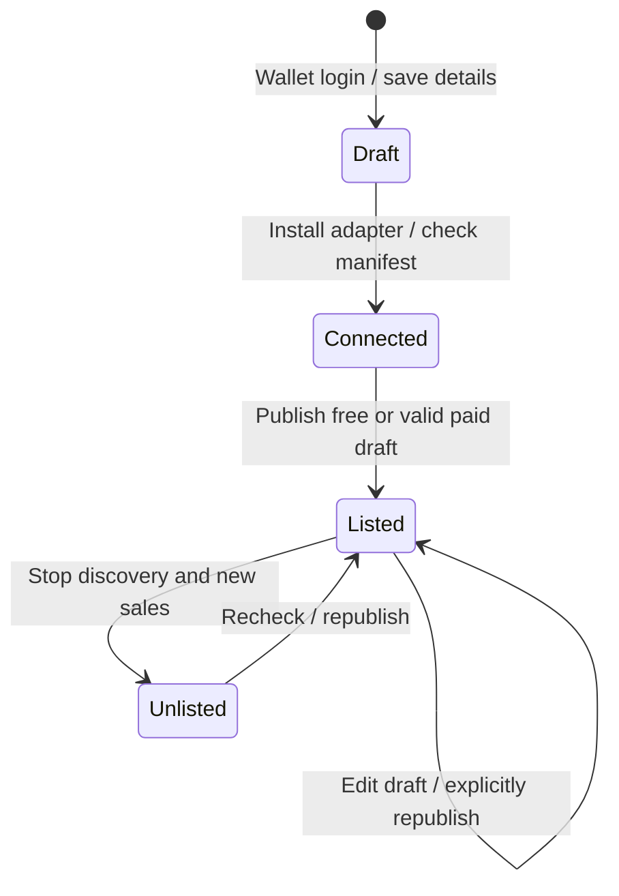
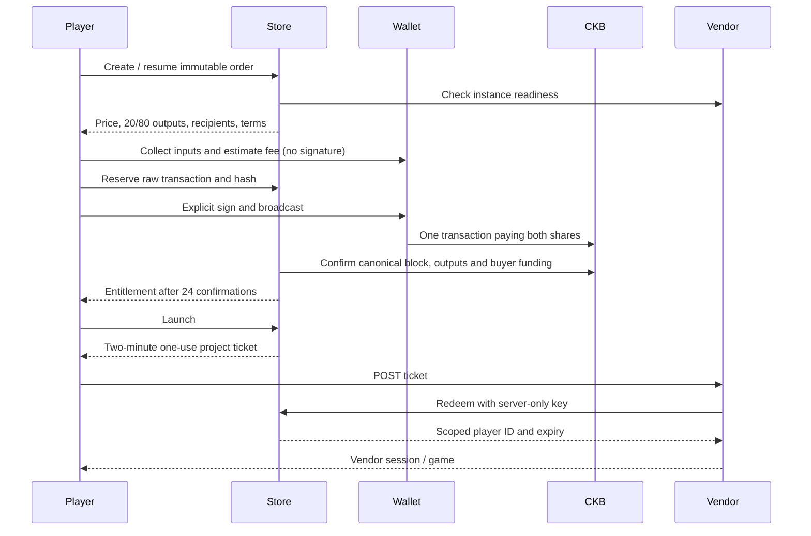

# UTXOPlay marketplace architecture and business-flow audit

Release: 0.5.0. Settlement policy: CKB mainnet; one purchase grants account access with no scheduled expiry; Store 20%, vendor 80%. Free publication is the default and carries no listing charge. Vendors operate and pay for their own Myelin runtime and HTTPS game hosting.

## Surfaces and responsibility

| Surface | Responsibility |
| --- | --- |
| Discover / game page | Search, genre/play-style/free filters, clear price and external host, guest free play, wallet purchase |
| Studio | Wallet-owned private drafts; three-step publication; instance check; free/paid pricing; live version management; sales receipts |
| Purchases / library | Immutable receipts, pending confirmation, retrying one reserved transaction, retained access after unlisting |
| Store service | Authentication, catalog, quotes, chain verification, entitlements, single-use launch tickets |
| Vendor adapter | HTTPS manifest, server-side ticket redemption, scoped session cookie, private HTTP/WebSocket runtime gateway |
| Vendor Myelin runtime | Game rules, isolated player state, signed execution records, game-specific replay/export |
| CKB mainnet | Atomic transfer of both revenue shares; public transaction history |

Store 0.5.0 leaves the four existing first-party runtimes and pinned verifiers unchanged. Third-party game code runs on vendor origins. No vendor key or runtime token is exposed to the game browser. The interoperability check is not remote attestation or content moderation.

## Publication

The `projects` table retains ownership and existing records. Additive `listings` rows hold draft JSON, revision, a separate live snapshot, listed flag, check result, verification nonce and key hash. Optimistic revision checks prevent stale tab saves. Publication repeats the network/configuration check. Saving never changes live pricing, URLs or controls. A one-time displayed project key authorizes only redemption for that project. Generating/rotating it invalidates previous connection checks.

Instance checks permit public HTTPS on port 443, with no URL credentials/query/fragment. DNS must resolve exclusively to public addresses. The checked address is pinned for the HTTPS request; certificate verification remains enabled. Redirects, large responses and non-JSON manifests are rejected, and requests have deadlines. Matching manifest fields include project ID, nonce, key fingerprint, runtime name, game URL and launch URL. The reference adapter probes its own private runtime. A malicious vendor can still lie about its own software; this release does not claim otherwise.

## Payment and access

Amounts use integer shannons; Store share is `floor(total / 5)`, vendor gets the remainder. Prices accept at most eight decimals. The minimum is computed from occupied capacity of each receive lock, not a fixed UI constant. See [CKB cells](https://docs.nervos.org/docs/tech-explanation/cell) and [transaction structure](https://github.com/nervosnetwork/rfcs/blob/master/rfcs/0022-transaction-structure/0022-transaction-structure.md). Network fees are paid by the buyer separately. Input/change collection uses CCC; signing must preserve the reserved raw transaction hash.

An order stores the buyer, vendor, game, immutable recipients and scripts, integer price, chain tip at creation, expiry, prepared transaction, unique hash, status, confirmation count and last check time. A partial unique index admits one open order per buyer/game. Repeated create/prepare calls reuse it. Unprepared quotes expire after 30 minutes and can be cancelled. Once a raw transaction is reserved, the application never silently substitutes another payment: retry signs that same transaction. A transaction can unlock only one order. Rejecting an old quote after unlisting prevents new preparation; already reserved transactions remain honored because they may already have been broadcast.

The verifier uses uncached transaction and canonical block queries, requires a block newer than the quote's creation tip, exact 20/80 outputs, no unexpected typed cells/data, buyer-only change and at least one buyer-owned funding input. At 24 confirmations, it atomically updates the receipt and grants one entitlement. This is an application confirmation policy, not absolute finality: see [CKB transaction lifecycle](https://docs.nervos.org/docs/tech-explanation/transaction). Pending receipts are checked in a rotating background queue; failed network checks do not grant access. Launch rechecks paid purchases and suspends access after a reorganization until reconfirmation. Existing vendor cookies may remain usable for up to 24 hours.

Entitlements are Store database records, not NFTs. Free launches also retain access for that account if the vendor later charges. Guest grants last only as long as the guest identity cookie remains available; they do not migrate to a wallet. Unlisting hides discovery and new sales while preserving owners' library entries and launch access. Vendor hosting availability still determines whether the game can be played.

## Audit findings and changes

| Finding | Implemented behavior |
| --- | --- |
| A project draft did not publish anything | Complete save → connect → price → publish flow with public catalog integration |
| Hosting ownership and Myelin integration were unclear | Required vendor URL, ready/configuration check, reference HTTP/WS adapter, setup guide |
| Free and paid paths risked equal friction | Free selected/recommended, no payout fields or chain transaction for free games, free catalog filter |
| Paid quotes could be changed while paying | Immutable order snapshot, same-transaction retry, revision and listing-race checks |
| A client success message could incorrectly grant access | Server verifies CKB canonical chain and required confirmations |
| Revenue accounting was undefined | Direct 20/80 outputs, buyer receipts and confirmed vendor revenue; no withdrawal balance |
| Minimum CKB capacity could fail only at checkout | Address-specific minimum check in Studio and server publication validation |
| Editing or unlisting could remove access | Separate live/draft snapshots, retained grants, owner-visible unlisted game pages |
| Errors could encourage duplicate payment | Persistent receipt, status polling, explicit pending/retry guidance, no second manual-payment CTA |
| External game launch could expose Store authority | Single-use POST ticket, project key, vendor cookie and scoped player ID; no wallet proof forwarding |
| Leaving an editor could lose unsaved work | Explicit keep-editing/discard UI, saved draft at each completed step |

## Operations and limits

Configure `STORE_CKB_ADDRESS` with the operator's actual public CKB mainnet receive address in the server environment. Never put a private key in the Store. When unset, paid publication/checkout is unavailable with a clear message; free publication and paid draft editing work. Invalid mainnet addresses fail validation when settlement is checked. No default or sample recipient may be used in production.

Back up platform SQLite using its consistent backup API before schema rollout. Keep the existing database, game volumes, authority keys and matching game images. Deploy only the Store service for this release. The marketplace tables and `orders.checked` column are additive; an older Store can run against the database, but would hide the new business features. Do not roll back after accepting payments without preserving and operating receipt reconciliation and owner access.

Receipts can contain public-chain addresses and transaction hashes; they are private to the buyer and relevant vendor through authenticated APIs. Runtime tickets expire in two minutes and are deleted on redemption. Session/key rotation and support procedures are in the vendor guide. No payout secret is stored by the Store.

The release does not add automated refunds, escrow, disputes, transferable ownership, custom cover uploads, malware/content certification, chain-only recovery of entitlements, scheduled backups or guaranteed vendor uptime. A reserved transaction whose inputs are spent elsewhere may require support; the application intentionally does not create a replacement charge while payment status is unresolved. Production receipt reconciliation and backups need operator monitoring. Fiber remains a separate optional testnet experiment.

## Verification

Automated tests cover integer splits/minimum capacity, SSRF target rejection, project ownership and revision checks, free publication, launch ticket scope/expiry/replay, immutable quotes, reserved transaction shape, confirmation/reorganization behavior, retained owners after unlisting, canonical-chain/buyer-funding checks and adapter session boundaries. Payment verification tests use controlled RPC fixtures, not real mainnet transfers.

Browser tests use a localhost-only disposable database and cryptographic test login. Instance readiness is explicitly simulated there. They verify the actual Studio forms and public listing UX without publishing test games to the production catalog. Real wallet payment acceptance remains a separate mainnet check to be performed by the operator after supplying the Store receive address; no money is moved by this implementation workflow.

Local acceptance also passed with a real Myelin Chess runtime through the reference vendor adapter: cryptographic wallet login, free publication, readiness probe, one-use launch redemption, authenticated e2e4 move, verified replay/export and protected static access. `tests/live-vendor.mjs` requires the local runtime token; it uses a disposable Store database and never creates a payment. The vendor HTTPS/DNS boundary is represented locally in this test, not deployed as a public vendor service.

### Release acceptance — 23 October 2026

- `npm test`: 30/30 passed, including marketplace and existing authentication/gateway tests.
- `npm run build`: passed. Release image passed an isolated no-network boot/schema/catalog/guide/auth-boundary check.
- Local browser: three-step free publication; paid price/minimum/split review; purchase receipt and unpaid cancellation; mobile 390 px layout; unsaved-draft protection; free-only filtering. No browser console errors observed in that test session. The browser fixture used simulated instance checks and no funds.
- Real local vendor integration: Myelin Chess execution, signed replay/export and launch authorization passed through the reference adapter.
- Local and public deployment: Chess/Skyward state isolation, legal actions, stale-action rejection, replay/export and wallet sign-in/sign-out/save recovery passed.
- Production Store image `utxoplay:0.5.0` is healthy. Public HTTPS returned version 0.5.0, the four original catalog games and the new Studio/Purchases/guides/assets. Receipt and redemption APIs rejected unauthenticated requests. The in-app browser timed out opening the public Studio; browser interaction acceptance was local, while production validation used HTTPS/API requests.
- Consistent platform backup created before rollout. All four game container image IDs and start times remained identical across deployment.
- Production has no test listings or orders. `STORE_CKB_ADDRESS` remains unset: free publication is active; paid publication and checkout are deliberately unavailable pending the operator's public mainnet receive address. No mainnet transfer or funded wallet payment acceptance was performed.
